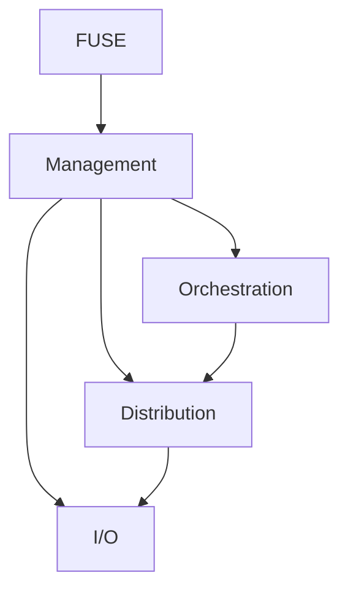

# Flexible RAID

Flexible RAID（FlexRAID）は、複数の通常ファイルシステム上にあるディレクトリをストレージとして利用し、FUSE 経由で単一の階層型ファイルシステムを提供する Linux 向けユーザー空間ファイルシステムです。メディアサーバーなど、複数ドライブにまたがるファイルストレージ用途を想定しています。


## 開発状況

FlexRAID は初期開発段階の実験的なソフトウェアです。基本的なファイル・ディレクトリ操作について pjdfstest による POSIX 互換性テストを実施していますが、すべての Linux / FUSE 機能、障害シナリオ、長時間稼働、性能特性を保証するものではありません。

- **本番環境の唯一のデータ保存先として使用しないでください。**
- RAID の冗長化はバックアップの代替ではありません。重要なデータは別媒体・別システムにもバックアップしてください。
- リリース前のため、永続化形式・API・設定は予告なく変更される可能性があります。既存データとの後方互換性は保証しません。
- 物理ディスクやその上のファイルシステムを直接操作・変更しないでください。FlexRAID が管理する保存領域を手作業で編集すると、データを失う可能性があります。

## 主な特徴

- 複数の独立したディスク上のディレクトリをまとめて一つのファイルシステムとして公開
- 通常のファイルシステム上のファイルを物理保存単位として使用（生ディスクへの直接アクセスは行わない）
- ファイルごとに冗長化・配置方式を持つ設計
- ミラーリングと XOR パリティ付きストライピング
- FUSE による Linux のファイルシステムインターフェース
- 物理ストレージの容量情報と、冗長化を考慮した配置可能容量の集計

## アーキテクチャ

FlexRAID は、外部インターフェースを担う FUSE / Management、論理・ストライプ処理を担う Orchestration / Distribution、物理ドライブ操作と OS 依存機能を一元化する I/O で構成します。raw な物理ファイル操作は I/O 内部に隠蔽します。依存関係は次の DAG です。矢印は呼び出し元から呼び出し先への依存を表します。



- **FUSE** — go-fuse と Management のアダプターです。OS の callback を Management のファイルシステム API に変換し、結果・エラーを FUSE の形式へ写像します。
- **Management** — ファイルシステム操作、管理操作、監視、制御の公開窓口です。システム全体の実行状態と操作受付可否を所有し、起動・初期化・停止を統括します。各操作は状態による事前判定、必要なロック取得、ロック取得後の状態再確認を経て実行します。Orchestration と Distribution の統括、Object 単位の排他制御、Cleanup / Recovery 等の管理タスク調整、操作メトリクスの集計も担当します。
- **Orchestration** — Header、論理 Object、Namespace、ファイル offset、ストライプ geometry、配置方針を管理します。通常のファイル操作では Distribution を直接利用し、論理ファイルの意味を保ったままストライプ単位の要求へ変換します。
- **Distribution** — 論理ストライプをチャンクへ分割し、ミラー / パリティを生成し、Version・物理配置・復旧を管理します。同一 ObjectID + StripeID の競合を防ぐ Stripe 単位の排他制御も所有します。
- **I/O** — 物理ドライブ操作の唯一の公開窓口です。物理ファイルの読み書き・同期・列挙・削除・保全退避に加え、OS 固有の容量・デバイス識別・能力プローブ・状態監視・電源制御を提供します。OS 差異は I/O パッケージ内の非公開実装で吸収し、独立した Platform パッケージは設けません。

### 操作経路と責務境界

通常の FUSE ファイル操作は `FUSE -> Management -> Orchestration -> Distribution -> I/O` の経路を通ります。Distribution と Management は物理ドライブ操作を I/O に依頼します。Management は Orchestration と Distribution の両方を直接利用できる統括レイヤーですが、Orchestration と Distribution の親子関係は維持します。Management から Distribution への直接呼び出しは、論理ファイル操作を必要としない Cleanup の物理処理や監視情報の取得などに限定し、通常のファイルデータ操作を Orchestration 経由から迂回させません。

Management が提供する外部 API は次の領域を想定します。

- **Filesystem API** — FUSE が必要とする Lookup / Getattr / Read / Write / Create / Rename 等の論理ファイルシステム操作。
- **Administration API** — Cleanup / Recovery / Scrub 等の管理タスクの開始・進捗確認・キャンセル。
- **Monitoring API** — 操作回数・所要時間・結果、ドライブ別 I/O エラー数などの状態・統計 snapshot の取得。
- **Control API** — 管理タスクの pause / resume や実行制御。個々の物理 I/O の意味解釈は行わない。

通常のファイル操作は結果・エラーを同期的に返します。長時間の管理タスクは、呼び出し元を物理削除や復旧の完了まで拘束せず、有限単位の処理と進捗を扱える API とします。

### 排他制御と Cleanup

システム全体の実行状態と操作受付可否は Management が所有します。各操作は下位レイヤーを呼び出す前に現在の状態で受付可能か判断し、必要な Object / メンテナンスロックを取得した後にも状態と操作前提を再確認します。ロック待機中の状態変更や、状態遷移と処理開始の競合を防ぐため、Management は受付済み操作の admission と状態遷移を同期します。状態遷移では新規受付を止め、遷移先の契約に応じて進行中操作の完了またはキャンセルを待ちます。
 
Namespace / Header / Runtime の論理状態は Orchestration が所有し、Management が必要な Object ロックを取得したうえで Orchestration API を呼び出します。異なる Object の操作を全体 mutex で一律に直列化せず、親 Directory や対象 Object など操作に必要なロック範囲で並行性を保ちます。

Distribution はストライプ状態を所有し、同一 ObjectID + StripeID の Read / Write / Recovery / Cleanup を直列化する Stripe ロックを所有します。Management / Orchestration はこの内部ロックを直接操作しません。I/O は物理ファイル操作を実行し、上位層の Object / Stripe ロックを管理しません。

削除は論理削除と物理削除を分離します。Orchestration は Header の Deleted 状態を永続化し、起動時の整合性検査を通過した削除済み ObjectID の候補一覧を Management へ返します。Management はこの永続状態から再構築可能な一時的削除待ちキューを所有し、Cleanup の実行タイミング・実行量を制御します。Distribution は旧 Version・孤立チャンク・論理削除 Object の Stripe / Chunk 単位の物理削除候補と処理結果を管理し、有限単位で物理削除します。Object 全体の物理削除では Stripe 0 / Header を最後に処理し、全 Stripe の削除完了後に Management が Orchestration へ Object のメモリ状態の確定を依頼します。

Management と I/O を含む構成は今後の目標アーキテクチャです。現行実装では FUSE が Orchestration を直接呼び出し、Orchestration が mutex と削除待ちキューを所有しており、システム状態による受付制御も Management には集約されていません。また、物理ファイル操作と OS 固有の環境情報取得は I/O に集約し、OS 差異は I/O パッケージ内の非公開実装で吸収します。Management 導入時は、排他制御・削除待ちキュー・システム状態と操作受付判断・初期化ライフサイクルを段階的に移行します。Orchestration のロックやキューを単に削除して整合性を失わせず、永続 Header の Deleted 状態から Management のキューを再構築できるようにします。

## 初期実装のデータ配置

- ストレージディレクトリは最低4つ必要です。5つ以上も指定でき、台数に上限はありません。新しいストライプの配置では、必要なチャンク数の I/O を `AvailableBytes` の多い順に選択し、余分なディレクトリは配置候補として待機します。
- Mirror は複数コピーを保存します（現在の容量計算・既定構成では 2 コピー）。
- XOR Parity は既定で 3 データチャンク + 1 パリティチャンクを使用します。データチャンク数・パリティ数は現行 CLI の YAML から変更できません。
- XOR パリティで復元できるのは、1 ストライプ内のデータチャンク 1 個の欠損までです。
- 配置済みデータの読み込みでは、現在の設定ではなく保存済みの配置情報を使用します。
- Stripe 0 の先頭 1 KiB は Header 用に予約されます。Stripe 0 の物理チャンクサイズは 4 KiB 固定で、後続ストライプのチャンクサイズは Header に記録されます。
- ファイルサイズ上限は 16 TiB、名前長の上限は 255 bytes です。

復旧はチャンクの欠落または物理読み取りエラーを対象とします。読み取れたデータ同士の比較やパリティ不一致から、正しい内容を推測・訂正する機能はありません。サイレントデータ破損や改ざんの検出を保証しません。

## FUSE / POSIX の対応状況

以下は FlexRAID の FUSE アダプターが実装している操作の範囲です。Linux カーネル、FUSE、マウント環境によって利用者から見える挙動が異なる場合があります。

### 対応している操作

- パス検索・属性取得・ディレクトリ一覧（Lookup / Getattr / Readdir）
- 通常ファイルの Open / Read / Write
- Create、Mknod（通常ファイルのみ）
- Mkdir、Rmdir
- Unlink、Rename、Hard Link、Symbolic Link、Readlink
- Setattr（mode、uid、gid、size、atime、mtime）
- Flush、Fsync、Release
- Statfs

権限判定は FUSE の `default_permissions` を有効にし、基本的にカーネル側へ委ねます。FUSE mount は `allow_other` を指定します。

### 非対応・制限事項

- **FIFO / named pipe** — 作成非対応。Mknod / mkfifo は `EOPNOTSUPP`。
- **キャラクタデバイス / ブロックデバイス** — 作成非対応。Mknod は `EOPNOTSUPP`。
- **UNIX domain socket** — 作成非対応。
- **Tmpfile（名前を持たない一時ファイル）** — 非対応。
- **拡張属性（xattr）** — get / set / list / remove の各操作は未実装。
- **Fallocate** — 事前領域確保 API は未実装。
- **Lseek の SEEK_DATA / SEEK_HOLE** — 専用 callback は未実装。
- **POSIX advisory locks** — FUSE の Getlk / Setlk / Setlkw は未実装で、マウント時にも有効化していません。

Mknod は通常ファイル（`S_IFREG`）だけを作成します。ファイル種別が指定されていない場合は `EINVAL`、特殊ファイル種別は `EOPNOTSUPP` を返します。特殊ファイルを通常ファイルとして代用することはありません。

上記以外の FUSE / Linux 機能についても、実装・テスト済みと明記されていないものはサポートを保証しません。

## 必要環境

- Linux
- Go 1.25 以上（ソースからビルドする場合）
- FUSE 3 のユーザー空間ツール（例: `fusermount3`）および利用可能な FUSE デバイス（通常は `/dev/fuse`）
- ストレージ用ディレクトリを作成・読み書きできる権限
- マウントポイントを作成・マウントできる権限

## ビルド

リポジトリのルートで実行します。

```sh
go build -o flexraid ./main
```

## 設定

Management が起動時に YAML 設定を読み込みます。ストレージは **4つ以上** 指定してください。各 disk の `root`・物理ファイルシステムの `mountpoint`・`wwn` は必須の組で、各値は設定内で一意にしてください。FlexRAID 全体の `mountpoint` は各物理ディスクの mountpoint と別に指定します。データチャンク数・パリティ数・最大チャンクサイズを指定する YAML 項目はなく、現行 CLI は既定の 3 データチャンク + 1 パリティ構成を使用します。

```yaml
disks:
  - root: /srv/flexraid/disk1/data
    mountpoint: /srv/flexraid/disk1
    wwn: 0x5000000000000001
    cleanup_delete_allowed: false
    cleanup_preserve_allowed: false
  - root: /srv/flexraid/disk2/data
    mountpoint: /srv/flexraid/disk2
    wwn: 0x5000000000000002
  - root: /srv/flexraid/disk3/data
    mountpoint: /srv/flexraid/disk3
    wwn: 0x5000000000000003
  - root: /srv/flexraid/disk4/data
    mountpoint: /srv/flexraid/disk4
    wwn: 0x5000000000000004
mountpoint: /mnt/flexraid
```

各 `disks` エントリーでは FlexRAID の保存ディレクトリ `root`、物理ディスク上のファイルシステム `mountpoint`、物理ドライブの `wwn` を必ず一組で指定します。WWN は Linux の `/dev/disk/by-id/wwn-` に続く値です。起動時に全 WWN を物理ブロックデバイスとして解決できない場合は、ストレージディレクトリを作成する前に起動を失敗させます。

各ドライブでは `cleanup_delete_allowed` と `cleanup_preserve_allowed` を独立して指定できます。どちらも省略時は `false`（禁止）です。前者は旧 Version の物理削除、後者は異常 Version の保全領域への退避を許可します。稼働中の変更は Management の `SetDriveCleanupDeletePermission` / `SetDriveCleanupPreservePermission` API で行います。これらの設定・API は許可状態だけを変更し、それ自体で Cleanup を開始しません。実行タイミングと対象の選択は Management のスケジューリング／手動実行フローが制御します。

起動時に Management が各 WWN を Linux の物理ブロックデバイスへ解決できることを確認します。解決に失敗した場合は、ストレージディレクトリを作成する前に起動を中断します。ストレージ `root` と FlexRAID 全体の mountpoint が存在しない場合は必要なディレクトリを作成します。既存のストレージ `root` に FlexRAID のデータがある場合は、その Namespace を読み込んで再マウントします。空の場合は root Directory を初期化します。新しいストライプの配置では、必要なチャンク数の I/O を `AvailableBytes` の多い順に選択します。既定の XOR Parity は4チャンクを必要とするため、5つ以上のディレクトリを指定しても1ストライプに使うのは4つで、残りは空き容量の変化などに応じた後続の配置候補になります。Mirror は2コピーを保存するため、配置時に空き容量の多い2ディレクトリを選択します。

## 起動・アンマウント

```sh
./flexraid -config /etc/flexraid.yaml
```

アンマウントは別のターミナルから行います。

```sh
fusermount3 -u /mnt/flexraid
```

マウント中は FlexRAID のプロセスを終了させず、先に正常にアンマウントしてください。

## データと整合性に関する注意

- 各ストレージディレクトリ内の物理ファイルは FlexRAID が管理します。名前変更・削除・編集をしないでください。
- ストライプ単位で新しいデータバージョンを書き込み、対象ストライプの必要なチャンク書き込みが完了してから成功を返します。書き込み途中で失敗した Version は実行中の最新有効 Version に切り替えませんが、書き込み済みチャンクは物理的に残る場合があります。
- 起動時は各ストライプの Version を個別に検証し、復元可能なもののうち最も新しい Version を選択します。したがって、以前に書き込み失敗した Version でも残存チャンクだけで復元可能なら、再起動後に選択される場合があります。新しい Version が復元不能なら、以前の復元可能 Version にフォールバックします。
- Mirror は複製が1つ以上あれば復元できます。XOR 1 パリティはデータチャンク1つの欠損まで復元できます。2つ以上のデータチャンクが欠損した場合は復元できません。
- これは複数ストライプ・複数 Namespace Object にまたがるトランザクションを意味しません。複数 Header を更新する操作のクラッシュ時原子性は保証されません。
- ディスク故障や読み取りエラーからの復旧能力は、選択された配置方式と残存チャンクに依存します。冗長性を超える障害ではデータを復旧できません。
- RAID は誤削除、ランサムウェア、ホスト故障、火災などからデータを保護するバックアップではありません。

## 開発者向けテスト

Go のテストは次のコマンドで実行します。

```sh
go test ./...
```

POSIX の基本操作は pjdfstest を用いて検証します。FlexRAID v1 でサポートしない特殊ファイルなどを前提とする一部ケースは、リポジトリ内の `tools/pjdfstest-flexraid-skiplist.tsv` に理由を記録したうえで SKIP とします。実装済み機能の不具合を SKIP で隠すことは認めません。

詳細な実装規約は `AGENTS.md` を参照してください。

## Worker 管理 gRPC API

Worker は Management が所有する通常の gRPC サーバーを提供します。通信には Unix Domain Socket と Protocol Buffers を使用します。サーバーはファイルシステムの初期化完了を待たずに Management の起動時に開始し、Management の停止時に終了します。Lifecycle Phase（Initializing / Ready / Draining / Maintenance / Failed）とは独立して接続でき、状態照会では現在の Phase を返します。監視情報の一部が取得できなくても RPC 全体をエラーにはせず、同じ Response の中で取得できた項目を返します。取得できない項目は値を未設定（Go の Response 型ではゼロ値）とし、対応する Available フラグを false、Error フィールドに取得失敗の理由を設定します。

Socket は `grpc_socket_path` で指定し、権限 `0600` で作成します。起動時に同じパスの Socket へ接続できる場合は二重起動を拒否し、接続できない stale Socket のみを削除して再作成します。通常ファイルやシンボリックリンクは stale Socket として扱いません。

### 提供する RPC

Protocol Buffers の `WorkerService` は、単一 Worker（論理ドライブ）の監視・メンテナンス操作を提供します。

- `GetStatus`: Lifecycle Phase と簡易状態
- `GetDetailedStatus`: ドライブ別の詳細状態
- `Inspect`: 詳細な監査情報
- `SpinUp` / `SpinDown`: WWN を指定した物理ドライブの電源制御
- `GetDriveCleanupPermissions`: ドライブ単位の Cleanup 許可設定の取得
- `SetDriveDeprecatedVersionDeletionPermission`
- `SetDriveAbnormalDataPreservationPermission`
- `SetDriveLogicalObjectDeletionPermission`

ファイルや Namespace の作成・削除・内容変更など、ユーザーデータを直接操作する RPC は提供しません。gRPC の transport と handler は Management パッケージ内にあり、Management の公開 API を通じて処理します。

### Worker の設定

Worker の設定ファイルは YAML です。現在読み込まれる項目は次のとおりです。

```yaml
disks:
  - root: /data/disk1
    mountpoint: /mnt/disk1
    wwn: "0x5000000000000001"
    cleanup_delete_deprecated_versions_allowed: true
    cleanup_preserve_abnormal_data_allowed: false
    cleanup_delete_logical_objects_allowed: false
  - root: /data/disk2
    mountpoint: /mnt/disk2
    wwn: "0x5000000000000002"
  - root: /data/disk3
    mountpoint: /mnt/disk3
    wwn: "0x5000000000000003"
  - root: /data/disk4
    mountpoint: /mnt/disk4
    wwn: "0x5000000000000004"

mountpoint: /mnt/flexraid
grpc_socket_path: /run/flexraid/worker.sock
```

- `disks` には4台以上を指定し、各ディスクに `root`、物理 `mountpoint`、一意な `wwn` を設定します。
- Cleanup 許可設定は省略時に false です。
- `mountpoint` は FlexRAID の FUSE マウント先です。ディスクの root / 物理 mountpoint と同じパスにはできません。
- `grpc_socket_path` は必須です。

### Management の監視 API

Management は用途別に3つの公開 API を提供します。

- `GetStatus`: Lifecycle と Distribution の集約異常数だけを返す簡易確認。物理デバイスや容量の問い合わせは行いません。
- `GetDetailedStatus`: Distribution の集約統計と、I/O が保持する設定順の各物理ドライブの物理操作統計、WWN 解決結果、ファイルシステム容量を返します。個別取得に失敗した項目は、そのドライブの取得エラーとして返し、他ドライブの情報を隠しません。
- `Inspect`: 詳細監視に加え、Distribution の Object / Stripe / Version / Orphan Chunk の物理配置情報と、Orchestration が保持する論理 Namespace / Object / 初期化時警告、Cleanup worker の稼働状態、ドライブ別 Cleanup 許可設定、Orchestration が算出する現在の論理空き容量を返す監査 API です。

物理ドライブ情報の取得に失敗した値は補完・推測しません。容量には取得元と取得時刻を付けます。これらの監視 API は standby デバイスを起こすための SpinUp を実行しません。物理操作統計は I/O が保持する Drive 順で返します。 `GetStatus` は Distribution の累積異常カウンターを使うため Stripe map を走査せず、Stripe 数などの inventory は含めません。`GetDetailedStatus` は全体 I/O / 容量集計とドライブ別 Cleanup 許可・Orphan Chunk 数・現在の論理空き容量を含みます。`Inspect` は Distribution のメモリ上の物理配置 snapshot と Orchestration の Namespace snapshot を返します。 Orphan Chunk は Distribution が識別できる物理ドライブ別件数も含みます。Namespace の到達可能性は root からの探索と HardLink 参照を考慮します。Distribution の Cleanup 候補件数・物理ファイルサイズは種別別・ドライブ別に集計し、削除候補のファイルサイズを加算した物理空き容量と、その容量を使った Mirror / Parity の論理空き容量を見積もります。この容量見積もりはファイル長に基づく概算であり、ファイルシステムの実割当ブロック数を保証するものではありません。

簡易 Status は Distribution のメモリ上の異常カウンターと Lifecycle / Cleanup worker 状態のみを参照し、Stripe map の全走査を行いません。詳細 Status はドライブ別 Cleanup 許可設定、論理空き容量、物理容量と I/O の全体集計を返します。